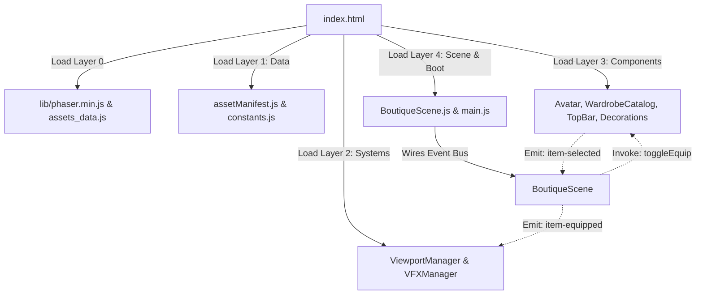

# Glow Up Boutique 
---

## 📑 Table of Contents
- [Glow Up Boutique](#glow-up-boutique)
  - [📑 Table of Contents](#-table-of-contents)
  - [Core Architecture \& How It Works](#core-architecture--how-it-works)
    - [1. Decoupled Event-Driven Communication](#1-decoupled-event-driven-communication)
  - [Directory Tree \& Project Layout](#directory-tree--project-layout)
  - [File Classification Guide](#file-classification-guide)
    - [1. 🟢 Frequently Modified Files (Content \& Layout)](#1--frequently-modified-files-content--layout)
    - [2. 🟡 Conditionally Modified Files (Feature-Specific)](#2--conditionally-modified-files-feature-specific)
    - [3. 🔵 Engine Files (Rarely Opened)](#3--engine-files-rarely-opened)
    - [4. 🔴 Do Not Modify](#4--do-not-modify)
  - ["What Do You Want to Do?"](#what-do-you-want-to-do)
    - [Quick Action Matrix](#quick-action-matrix)
    - [Recipe 1: Add a New Item to the Catalog](#recipe-1-add-a-new-item-to-the-catalog)
    - [Recipe 2: Remove an Item from the Catalog](#recipe-2-remove-an-item-from-the-catalog)
    - [Recipe 3: Remove or Hide a Category Tab](#recipe-3-remove-or-hide-a-category-tab)
    - [Recipe 4: Fine-Tune an Item's Position \& Scale on the Avatar](#recipe-4-fine-tune-an-items-position--scale-on-the-avatar)
    - [Recipe 5: Replace the Base Avatar Character](#recipe-5-replace-the-base-avatar-character)
    - [Recipe 6: Change the Game Typography / Font](#recipe-6-change-the-game-typography--font)
    - [Recipe 7: Replace the Background Wallpaper](#recipe-7-replace-the-background-wallpaper)
    - [Recipe 8: Replace HUD Badge Assets or Adjust Their Layout](#recipe-8-replace-hud-badge-assets-or-adjust-their-layout)
    - [Recipe 9: Reposition General UI \& Gameplay Elements](#recipe-9-reposition-general-ui--gameplay-elements)
  - [Running the Game](#running-the-game)
    - [Option 1: Direct File Launch (No Web Server Needed)](#option-1-direct-file-launch-no-web-server-needed)
    - [Option 2: Using a Local Development Server](#option-2-using-a-local-development-server)

---

## Core Architecture & How It Works

The codebase strictly decouples **Configuration Data**, **Visual Components/Models**, and **Engine Systems (Viewport & VFX)**:



### 1. Decoupled Event-Driven Communication
* `Avatar.js` **never** directly references `WardrobeCatalog.js`.
* `WardrobeCatalog.js` **never** directly references `Avatar.js`.
* **Execution flow:**
  1. Player taps or drags a garment from the catalog $\rightarrow$ `WardrobeCatalog` emits `item-selected`.
  2. `BoutiqueScene` catches the event and invokes `avatar.toggleEquip(itemData)`.
  3. `Avatar` updates its internal equipment state, renders the sprite layer, and emits `item-equipped` or `item-unequipped`.
  4. `BoutiqueScene` responds by:
     - Requesting `WardrobeCatalog.updateGridBorders()` to refresh yellow active borders.
     - Triggering `VFXManager.spawnFloatingScore()` and sparkle bursts at the slot's configured anchor.

---

## Directory Tree & Project Layout

```text
glow-up-boutique/
├── index.html                  # HTML container, font preloaders, & script loader
├── assets_data.js              # Offline Base64 asset fallback bundle (~11 MB)
├── assets/                     # Physical static image assets (.png)
├── css/
│   └── style.css               # Global CSS reset, dvh viewport lock, & font styling
├── lib/
│   └── phaser.min.js           # Phaser 3.87.0 official minified engine build
└── src/
    ├── main.js                 # Phaser.Game bootstrap entry point
    ├── config/
    │   ├── constants.js        # UI coordinates, palette tokens, & typography
    │   └── assetManifest.js    # Asset registry, catalog catalog data, & calibrations
    ├── systems/
    │   ├── ViewportManager.js  # High-DPI resize, visualViewport, & bleed scaling
    │   └── VFXManager.js       # Procedural 4-point sparkles, celebrations, & popups
    ├── components/
    │   ├── Avatar.js           # Character mannequin, dynamic slots, & idle breathing
    │   ├── WardrobeCatalog.js  # Tab navigation, 3x3 grid, tap & drag-and-drop
    │   ├── TopBar.js           # HUD badges & occasion title pill
    │   └── Decorations.js      # Knowledge charm card, interactive butterfly, & finish button
    └── scenes/
        └── BoutiqueScene.js    # Master scene orchestrator wiring events & components
```

---

## File Classification Guide

### 1. 🟢 Frequently Modified Files (Content & Layout)
When you need to **adjust the position of clothes or glasses, add items to the wardrobe, or reposition UI buttons**, work inside these files:

| File Path | Primary Responsibility | When Should You Edit This? |
| :--- | :--- | :--- |
| [`src/config/assetManifest.js`](file:///d:/FXM/br%20cancer/src/config/assetManifest.js) | **Garment Calibration & Catalog Data** | - Fine-tune `x, y` offsets and `wearScale` for items on the avatar.<br>- Add new garments, pants, skirts, dresses, or accessories.<br>- Remove items from categories.<br>- Register new image assets into `STATIC_IMAGES`.<br>- Modify avatar slot rendering order (`AVATAR_SLOTS`). |
| [`src/config/constants.js`](file:///d:/FXM/br%20cancer/src/config/constants.js) | **UI Coordinates, Palette, & Design Tokens** | - Reposition HUD badges, butterfly mascot, charm card, or finish button.<br>- Adjust the drag-and-drop hit boundary (`DROP_ZONE`).<br>- Modify color swatches (carpet fill, active tab color, slot borders).<br>- Configure typography styles (`TEXT_STYLES` & `FONT_STACK`). |

---

### 2. 🟡 Conditionally Modified Files (Feature-Specific)
These components are feature-complete and production-ready. **Only modify them if you are implementing specific new mechanics:**

| File Path | Modify ONLY IF you want to: |
| :--- | :--- |
| [`src/scenes/BoutiqueScene.js`](file:///d:/FXM/br%20cancer/src/scenes/BoutiqueScene.js) | - Add background audio (BGM) or sound effects (SFX).<br>- Implement scene transitions (e.g., navigating to a Results Scene or external URL on Finish).<br>- Alter cross-component event bindings. |
| [`src/components/Avatar.js`](file:///d:/FXM/br%20cancer/src/components/Avatar.js) | - Modify character body animations (breathing speed, idle bounce ease).<br>- Introduce new equipment slots (e.g., `hat`, `wings`, `jewelry`, or `facial_expression`). |
| [`src/components/WardrobeCatalog.js`](file:///d:/FXM/br%20cancer/src/components/WardrobeCatalog.js) | - Convert the catalog from a 3x3 grid into a horizontal swipe carousel.<br>- Implement catalog pagination (Next/Previous page buttons).<br>- Tweak tap versus drag gesture sensitivity. |
| [`src/components/TopBar.js`](file:///d:/FXM/br%20cancer/src/components/TopBar.js) | - Add dynamic numeric counters to HUD badges (e.g., animated coin incrementer). |
| [`src/components/Decorations.js`](file:///d:/FXM/br%20cancer/src/components/Decorations.js) | - Modify the butterfly mascot's flight tween or charm card idle rotation. |
| [`src/systems/VFXManager.js`](file:///d:/FXM/br%20cancer/src/systems/VFXManager.js) | - Replace procedural sparkle stars with custom animated sprite sequences.<br>- Add fireworks or custom confetti geometry upon dressing up. |
| [`css/style.css`](file:///d:/FXM/br%20cancer/css/style.css) | - Change outer body background color (`#fce4ec`) visible on ultrawide monitors.<br>- Adjust web font preloader rules. |

---

### 3. 🔵 Engine Files (Rarely Opened)
These files manage core engine infrastructure. **Avoid modifying them** unless undergoing a major architectural overhaul:

| File Path | Why You Shouldn't Need to Open This |
| :--- | :--- |
| [`src/systems/ViewportManager.js`](file:///d:/FXM/br%20cancer/src/systems/ViewportManager.js) | Handles mathematical letterboxing, safe viewport calculations, orientation change debounce, and High-DPI buffer allocation. Includes automatic listener and memory cleanup on scene destruction. |
| [`src/main.js`](file:///d:/FXM/br%20cancer/src/main.js) | Standard bootstrap entry point initializing `new Phaser.Game(config)`. Configures antialiasing, renderer type, and scale modes. |
| [`index.html`](file:///d:/FXM/br%20cancer/index.html) | Strict layered script loader for offline compatibility. Only open if you are linking a brand new script file or updating the Google Fonts CDN URL. |

---

### 4. 🔴 Do Not Modify

| File / Folder | Reason for Freezing |
| :--- | :--- |
| [`lib/phaser.min.js`](file:///d:/FXM/br%20cancer/lib/phaser.min.js) | **Phaser 3.87.0 Vendor Build**. Modifying vendor code risks breaking core game loop rendering and input systems. |
| [`assets_data.js`](file:///d:/FXM/br%20cancer/assets_data.js) | **Offline Base64 Asset Bundle (~11 MB)**. Pre-compiled fallback data allowing the game to boot directly from `file:///` without a web server. Do not edit manually. |


---

## "What Do You Want to Do?"

Use this reference table whenever you need to implement a common task:

### Quick Action Matrix

| Task / Goal | File to Modify | Target Code / Property |
| :--- | :--- | :--- |
| **1. Add a new item to the catalog** | [`src/config/assetManifest.js`](file:///d:/FXM/br%20cancer/src/config/assetManifest.js) | `STATIC_IMAGES`, `CATALOG_DATA`, `CALIBRATION` |
| **2. Remove an item from the catalog** | [`src/config/assetManifest.js`](file:///d:/FXM/br%20cancer/src/config/assetManifest.js) | Remove entry from `CATALOG_DATA[category]` array |
| **3. Remove or hide a category tab** | [`src/config/assetManifest.js`](file:///d:/FXM/br%20cancer/src/config/assetManifest.js) | Remove entry from `CATEGORIES` array & adjust `x` coordinates |
| **4. Reposition an equipped item on avatar** | [`src/config/assetManifest.js`](file:///d:/FXM/br%20cancer/src/config/assetManifest.js) | `CALIBRATION[category][id]` (`x`, `y`, `wearScale`) |
| **5. Replace the character avatar asset** | [`src/config/assetManifest.js`](file:///d:/FXM/br%20cancer/src/config/assetManifest.js)<br>*(optional)* [`src/config/constants.js`](file:///d:/FXM/br%20cancer/src/config/constants.js) | `STATIC_IMAGES` (key: `avatar_base`)<br>`LAYOUT.AVATAR.BASE_SCALE` (if image size changes) |
| **6. Change game typography / font** | [`index.html`](file:///d:/FXM/br%20cancer/index.html)<br>[`css/style.css`](file:///d:/FXM/br%20cancer/css/style.css)<br>[`src/config/constants.js`](file:///d:/FXM/br%20cancer/src/config/constants.js) | `<link href="...fonts.googleapis.com...">`<br>`body, .font-preload { font-family: ... }`<br>`const FONT_STACK = '...'` |
| **7. Replace background wallpaper** | [`src/config/assetManifest.js`](file:///d:/FXM/br%20cancer/src/config/assetManifest.js) | `STATIC_IMAGES` (key: `bg`) |
| **8. Replace HUD badge graphics** | [`src/config/assetManifest.js`](file:///d:/FXM/br%20cancer/src/config/assetManifest.js) | `STATIC_IMAGES` (`coin_badge`, `style_badge`, etc.) |
| **9. Reposition HUD badges** | [`src/config/constants.js`](file:///d:/FXM/br%20cancer/src/config/constants.js) | `LAYOUT.TOP_BAR` (`X`, `Y`, `scale`) |
| **10. Reposition avatar & carpet** | [`src/config/constants.js`](file:///d:/FXM/br%20cancer/src/config/constants.js) | `LAYOUT.AVATAR` (`X`, `Y`, `DROP_ZONE`) |
| **11. Change palette colors** | [`src/config/constants.js`](file:///d:/FXM/br%20cancer/src/config/constants.js) | `PALETTE` (`CARPET_FILL`, `SLOT_BORDER`, etc.) |

---

### Recipe 1: Add a New Item to the Catalog
*Example: Adding a new skirt named `pink_skirt` to the `pants` category:*

1. Place the PNG file inside `assets/catalog-pants/pink-skirt.png`.
2. Open [`src/config/assetManifest.js`](file:///d:/FXM/br%20cancer/src/config/assetManifest.js):
   - **Step A: Register the image path** in `STATIC_IMAGES`:
     ```javascript
     { key: 'pink_skirt', path: 'assets/catalog-pants/pink-skirt.png' },
     ```
   - **Step B: Add the item to catalog data** in `CATALOG_DATA.pants`:
     ```javascript
     pants: [
         { id: 'navy_skirt', key: 'navy_skirt', type: 'pants', thumbScale: 0.65 },
         { id: 'pink_skirt', key: 'pink_skirt', type: 'pants', thumbScale: 0.65 }
     ],
     ```
   - **Step C: Calibrate its position on the avatar** in `CALIBRATION.pants`:
     ```javascript
     pants: {
         navy_skirt: { wearScale: 1.12, x: -5, y: -15 },
         pink_skirt: { wearScale: 1.12, x: -5, y: -15 }
     }
     ```
The new skirt will immediately appear in the catalog grid!

---

### Recipe 2: Remove an Item from the Catalog
*Example: Removing garment #9 (`clothes_9`) from the tops catalog:*

1. Open [`src/config/assetManifest.js`](file:///d:/FXM/br%20cancer/src/config/assetManifest.js).
2. Locate `CATALOG_DATA.clothes`.
3. Simply remove the item object from the array. The 3x3 catalog grid automatically adjusts its rendered slots without throwing runtime errors.
4. *(Optional)* Remove key `9` from `CALIBRATION.clothes` to keep the configuration clean.

---

### Recipe 3: Remove or Hide a Category Tab
*Example: Hiding the `bag` and `shoes` categories:*

1. Open [`src/config/assetManifest.js`](file:///d:/FXM/br%20cancer/src/config/assetManifest.js).
2. Locate the `CATEGORIES` array (line ~42).
3. Remove the unwanted categories and adjust the remaining `x` positions to evenly distribute the tabs:
   ```javascript
   // Reduced to 4 active tabs: clothes, pants, dress, glasses
   CATEGORIES: [
       { id: 'clothes', logo: 'clothes_logo', x: 120 },
       { id: 'pants',   logo: 'pants_logo',   x: 270 },
       { id: 'dress',   logo: 'dress_logo',   x: 420 },
       { id: 'glasses', logo: 'glasses_logo', x: 570 }
   ],
   ```

---

### Recipe 4: Fine-Tune an Item's Position & Scale on the Avatar
*Example: Nudging sunglasses higher or scaling them down:*

1. Open [`src/config/assetManifest.js`](file:///d:/FXM/br%20cancer/src/config/assetManifest.js).
2. Locate `CALIBRATION` $\rightarrow$ `glasses` $\rightarrow$ `sun_glasses`:
   ```javascript
   glasses: {
       // wearScale : Size scale when equipped (e.g., 0.7 = 70% of source graphic)
       // x         : Horizontal offset (negative moves left, positive moves right)
       // y         : Vertical offset (negative moves up toward head, positive moves down)
       sun_glasses: { wearScale: 0.7, x: -10, y: -358 }
   }
   ```
3. Update `x`, `y`, or `wearScale`. Save and refresh your browser to inspect the result.

> [!NOTE]
> Coordinate `(0, 0)` refers to the center origin of the Avatar body. A value of `y: -358` places the sunglasses 358 pixels above the center origin (matching the mannequin's eyes).

---

### Recipe 5: Replace the Base Avatar Character
If your art team delivers a refreshed avatar or mannequin graphic:

1. Save the new asset into `assets/avatar/` (e.g., `assets/avatar/model-v2.png`).
2. Open [`src/config/assetManifest.js`](file:///d:/FXM/br%20cancer/src/config/assetManifest.js), and update the path for `avatar_base`:
   ```javascript
   { key: 'avatar_base', path: 'assets/avatar/model-v2.png' },
   ```
3. If the new character has different proportions or height:
   - Open [`src/config/constants.js`](file:///d:/FXM/br%20cancer/src/config/constants.js) $\rightarrow$ adjust `LAYOUT.AVATAR.BASE_SCALE` (e.g., from `1.235` to `1.15`).
   - Re-check and adjust `y` values in `CALIBRATION` to align with the new model's silhouette.

---

### Recipe 6: Change the Game Typography / Font
The game loads Google Fonts with automatic fallback to local rounded fonts when running offline:

1. Open [`index.html`](file:///d:/FXM/br%20cancer/index.html):
   - Replace the Google Fonts `<link>` tag in the `<head>` with your desired font family (e.g., **Poppins** or **Quicksand**):
     ```html
     <link href="https://fonts.googleapis.com/css2?family=Poppins:wght@600;700;800&display=swap" rel="stylesheet">
     ```
2. Open [`css/style.css`](file:///d:/FXM/br%20cancer/css/style.css):
   - Update `font-family` for `body` and `.font-preload`:
     ```css
     body, .font-preload {
         font-family: 'Poppins', sans-serif;
     }
     ```
3. Open [`src/config/constants.js`](file:///d:/FXM/br%20cancer/src/config/constants.js):
   - Update line 3:
     ```javascript
     const FONT_STACK = '"Poppins", "Arial Rounded MT Bold", sans-serif';
     ```
All UI hints, empty state notices, and floating score popups will automatically update to use the new font family.

---

### Recipe 7: Replace the Background Wallpaper
To update the room interior or wallpaper:

1. Save the image into `assets/UI/` (e.g., `assets/UI/room-bg-v2.png`).
2. Open [`src/config/assetManifest.js`](file:///d:/FXM/br%20cancer/src/config/assetManifest.js):
   - Update the path for key `'bg'`:
     ```javascript
     { key: 'bg', path: 'assets/UI/room-bg-v2.png' },
     ```
3. `ViewportManager.js` will automatically apply proportional **Cover Bleed** scaling to the new wallpaper without distortion on any device aspect ratio.

---

### Recipe 8: Replace HUD Badge Assets or Adjust Their Layout
The HUD features the boutique logo, coin badge, style badge, care badge, and title pill:

1. **To replace HUD graphics**:
   - Save the new image inside `assets/UI/HUD/`.
   - In [`src/config/assetManifest.js`](file:///d:/FXM/br%20cancer/src/config/assetManifest.js), update the path for the respective key:
     `'gloq_up'`, `'coin_badge'`, `'style_badge'`, `'care_badge'`, or `'title_badge'`.
2. **To reposition or resize HUD elements**:
   - Open [`src/config/constants.js`](file:///d:/FXM/br%20cancer/src/config/constants.js) $\rightarrow$ locate `LAYOUT.TOP_BAR`:
     ```javascript
     TOP_BAR: {
         GLOW_UP: { x: 160,  y: 68, scale: 1.15 },
         COIN:    { x: 935,  y: 66, scale: 1.6  },
         STYLE:   { x: 1325, y: 66, scale: 1.6  },
         CARE:    { x: 1820, y: 66, scale: 1.6  },
         PILL:    { x: 2321, y: 64, shadowY: 68, w: 930, h: 127, radius: 60 },
         TITLE:   { x: 2375, y: 88, scale: 1.45 }
     }
     ```
   - Adjust `x`, `y`, or `scale` to taste.

---

### Recipe 9: Reposition General UI & Gameplay Elements
Open [`src/config/constants.js`](file:///d:/FXM/br%20cancer/src/config/constants.js) $\rightarrow$ inspect `LAYOUT`:

```javascript
LAYOUT: {
    AVATAR: {
        X: 1704,  // Horizontal anchor (centered on 3408 canvas)
        Y: 840,   // Vertical anchor
        // Rectangular drop boundary for drag-and-drop detection
        DROP_ZONE: { x: 1320, y: 220, width: 768, height: 1120 }
    },
    CATALOG: {
        X: 155,   // Wardrobe card horizontal anchor
        Y: 256,
        WIDTH: 742,
        HEIGHT: 976
    },
    DECORATIONS: {
        CHARM:      { x: 155,  y: 1290 }, // Knowledge charm card (bottom left)
        BUTTERFLY:  { x: 2302, y: 1068 }, // Interactive animated butterfly
        FINISH_BTN: { x: 1704, y: 1440 }  // Finish celebration button (below carpet)
    }
}
```

---

## Running the Game

### Option 1: Direct File Launch (No Web Server Needed)
Simply **double-click `index.html`** in Windows File Explorer. The game will run immediately in your default browser using the `file:///` protocol without needing Node.js, local servers, or an internet connection.

### Option 2: Using a Local Development Server
If you prefer running via HTTP in your IDE or testing on mobile devices over local Wi-Fi:
* Use VS Code / Antigravity IDE's **Live Server** extension, or
* Run from PowerShell/Terminal:
  ```bash
  npx serve .
  ```
  Then navigate to `http://localhost:8080` in your browser.
